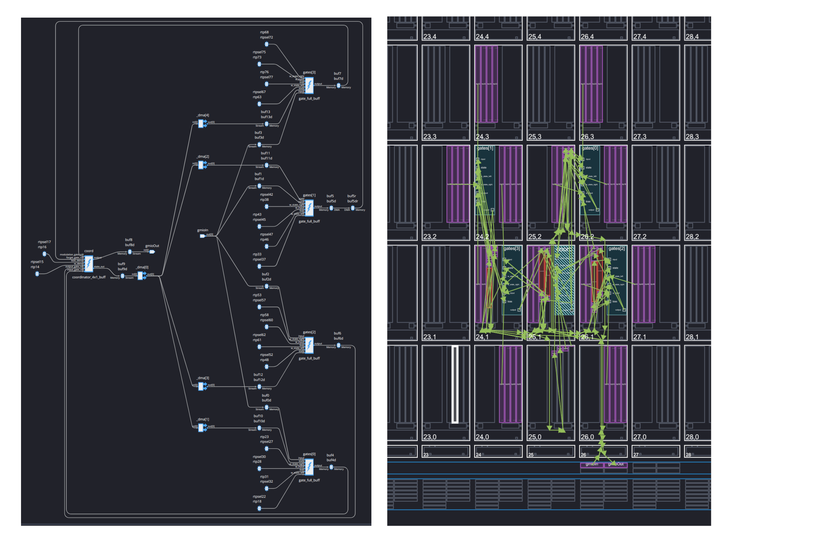
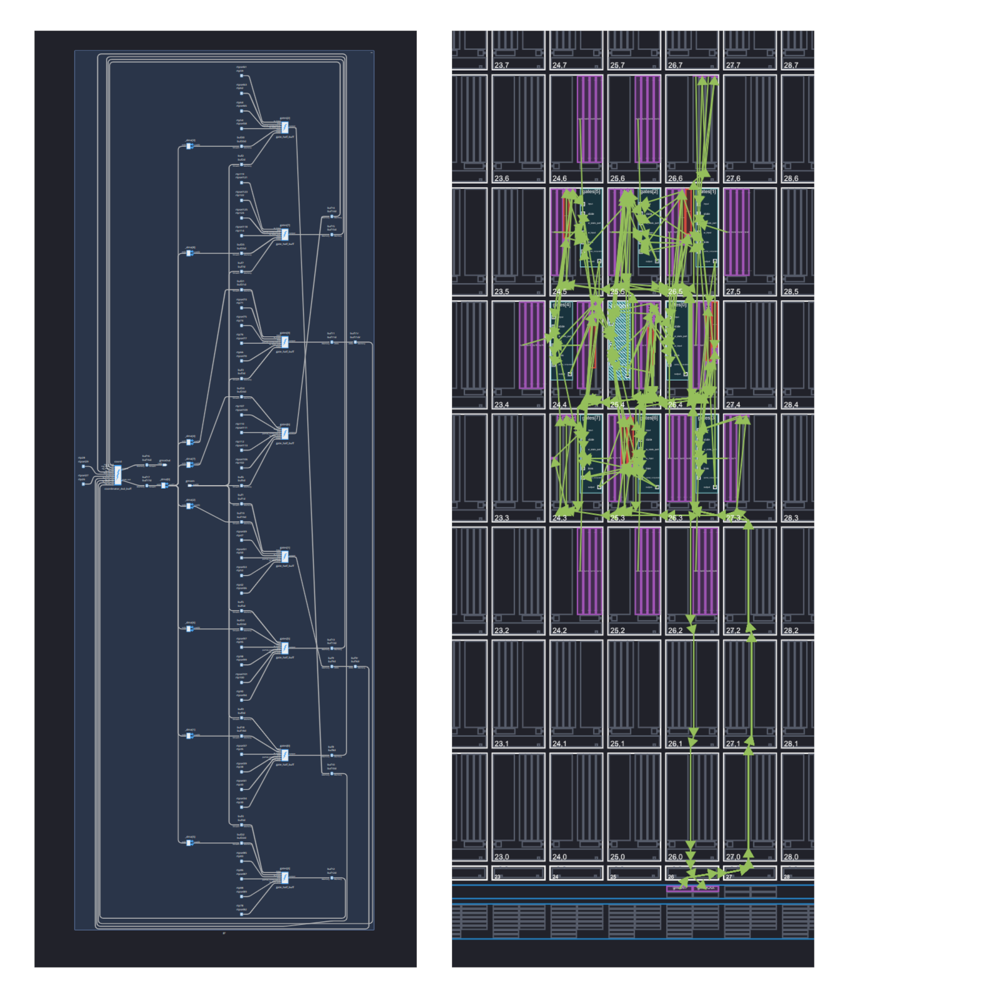
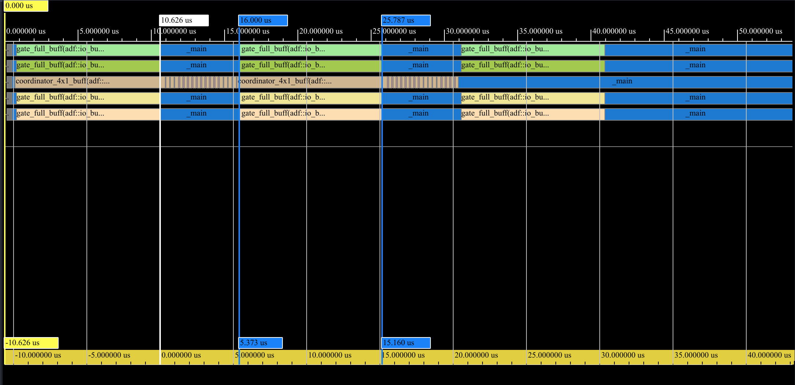
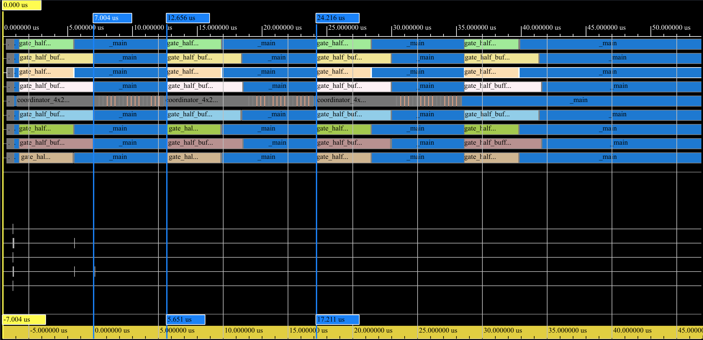

# Exploratory LSTM Implementation for AMD AI Engine

This project is an experimental exploration of implementing an LSTM network
using C++ graph and kernel API for 1st generation AI Engine architecture on
VCK190 Versal ACAP board.

<table stype="border: none;">
  <tr>
    <td align="center">
      
       
      <b>4 Core LSTM Block Graph and Array Placement</b>
    </td>
    <td align="center">
      
       
      <b>8 Core LSTM Block Graph and Array Placement</b>
    </td>
  </tr>
</table>

## Building and Running

Assuming the development environment is a GNU/Linux machine:

- Install Vitis 2025.2 from AMD's website and obtain a license with Versal ACAP
  AIEngine/AIE-ML development permission. After installation and license setup,
  activate the dev environment by sourcing the setup script:
      `. <vitis-2025-install-dir>/Vitis/settings64.sh`
  If successful, `XILINX_VITIS` environment variable should be available in the
  shell:
      `env | grep -i XILINX_VITIS`
- Build and run the functional x86 simulation with:
      `make build-x86sim && make run-x86sim`
- Build and run the cycle approximate `aiesimulator` with:
      `make build-hw && make run-aiesim-trace`
- To view the compile summary, run:
      `vitis_analyzer build_hw/main.aiecompile_summary`
- To view simulator trace, run:
      `vitis_analyzer build_hw/`

## Code Guide

- The gate kernels are implemented with vectorized matrix multiplication with 8
  lanes of single precision float per cycle using `aie::mac` API function. All
  the inner loops are software pipelined as much as possible with a loop II
  of 2. Each gate is assigned their individual cores and receives data through
  the synchronous I/O buffer interface.
- There is coordinator kernel which is responsible for feeding inputs to and
  collating outputs from all the gates. It is also responsible for state
  management in between the recurrent iterations which necessitates it to
  utilize the asynchronous I/O buffer interface.
- Weights and biases are loaded into 32KB scratchpad memory before graph
  execution begins. They are implemented as Run Time Parameter(RTP) buffers,
  exclusive to each gate.
- The [graph](./src/graphs.hpp) describes the interconnection between the
  kernels, using AMD ADF graph API. It also describes various meta information
  like placement constraints between the kernels.
- The [host shim](./src/main.cpp) is responsible for loading and invoking the
  graph along with allocating buffers for graph input/output using GMIO
  interface.
- There are three variants of the implementation. The `4X1_BUFF` variant uses 4
  cores for 4 gates and utilizes I/O buffer interface. The `4X2_BUFF` variant
  uses 2 cores per gate, increasing parallelization. `4X2_STRM` variant uses
  stream interface for inter-kernel communication. To build a particular
  variant(i.e. `4X2_STRM`), use:
      `make build-hw VARIANT=4X2_STRM && make run-aiesim-trace`
- There are three activation implementations for `sigmoid` and `tanh` functions.
  One using the math library that uses the scalar core, one using vectorized
  polynomial approximation and third one using vectorized piecewise linear
  approximation.

## About the Reference Implementation

The project was inspired by and compares to an internal implementation of LSTM
network written in C using non-SIMD standard library math, related to the
[dropbear project](). The code is available [here](./lstm_ref_code/test_lstm.c).
The network is a single LSTM block with dense layer before the output. It has an
input size of 20, hidden size of 100 and a cell/modulation gate, as well as the
usual three gates.

## Simulation Latency Analysis

| Variant | Gate 1st Latency | Network 1st Latency |
|---------|------------------|---------------------|
| 4 Core  | ~10.6µS          | ~16µS               |
| 8 Core  | ~7µS             | ~12.6µS             |

`4X1_STRM` variant is so slow that `vitis_analyzer` times out and hangs while
analyzing the vcd file. For all cases, simulation was done with the core clock
frequency set to 1250MHz and sampling interval of 1pS.

### 4 Core Variant Simulation Trace

### 8 Core Variant Simulation Trace

## Accuracy

As of writing this README in 2026, all three variants differ in results due to
state synchronization bug in at least two of them. They were introduced while
trying to optimize the loops for better latency. During the active phase of the
project in early 2025, I was meticulously measuring accuracy compared to the
reference implementation due to differences in activation function
implementation. I do not intend to identify or fix the issues as purpose of this
repository is mostly archival.

## Lessons Learned

- As apparent from trace, the coordinator loops are widely inefficient. At the
  point of inception of this project, I wasn't very aware about branching
  penalties in VLIW pipelines.
- Even the best `tanh` implementation using `aie::select` and piecewise linear
  approximation is so bloated that it can not effectively be inlined. There are
  better ways to implement `tanh` - either using a particular floating point
  trick or through lookup tables in AIE-ML.
- The matrix multiplication loops use `aie::reduce_add` to produce a scalar by
  summing all the vector lanes. In AI Engine, this is a multi-cycle, slow
  operation. There are better ways to data layout and loop design that requires
  no explicit reductions.
- While AI Engine has low-latency stream connections, they are rarely useful in
  bulk computation scenarios like neural network inference, unless there is a
  workload with abnormally high compute intensity.
- Scaling LSTM or any other neural network operator implementation without a
  compiler framework is dumb. For example, the best implementation here uses 8
  cores, while there are 400 cores available.

## License

Copyright © 2026 Titon Barua, Jason D. Bakos

Distributed under the MIT Public License.
