# Intro

## Outline

:::incremental

- AMD AIE hardware architecture
- Dropbear LSTM Implemented in AIE
- Three base designs
- **Mostly Loop optimization**

:::

## AIE Architecture Overview

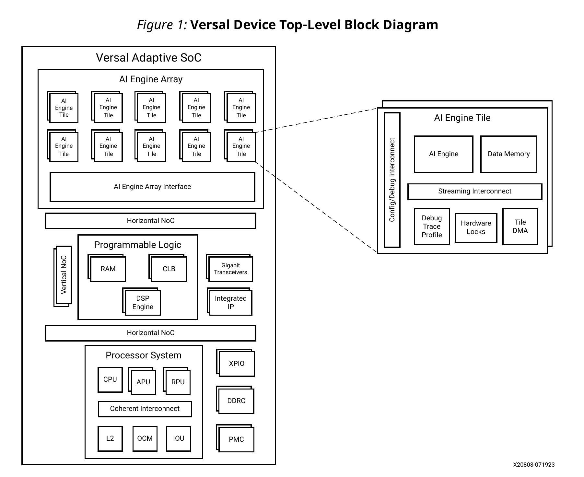 { width = "70% }


## AIE Architecture Overview

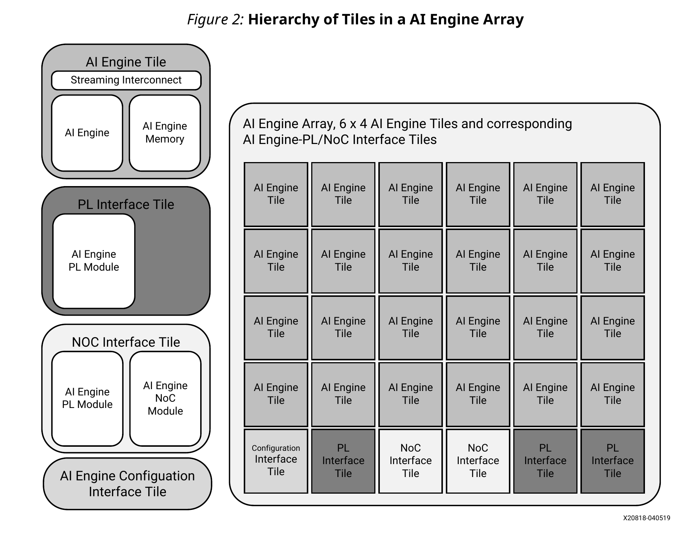

## AIE Architecture Overview

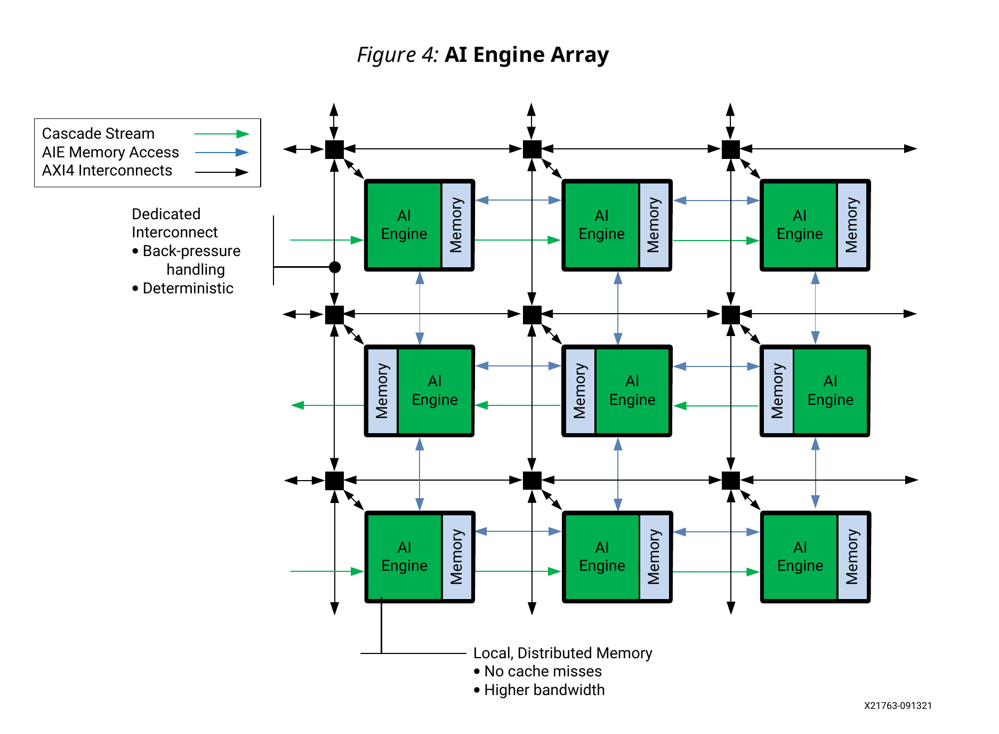

## AIE Architecture Booting

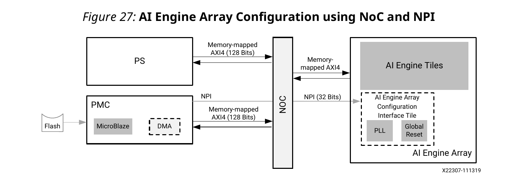


## AIE Architecture Booting

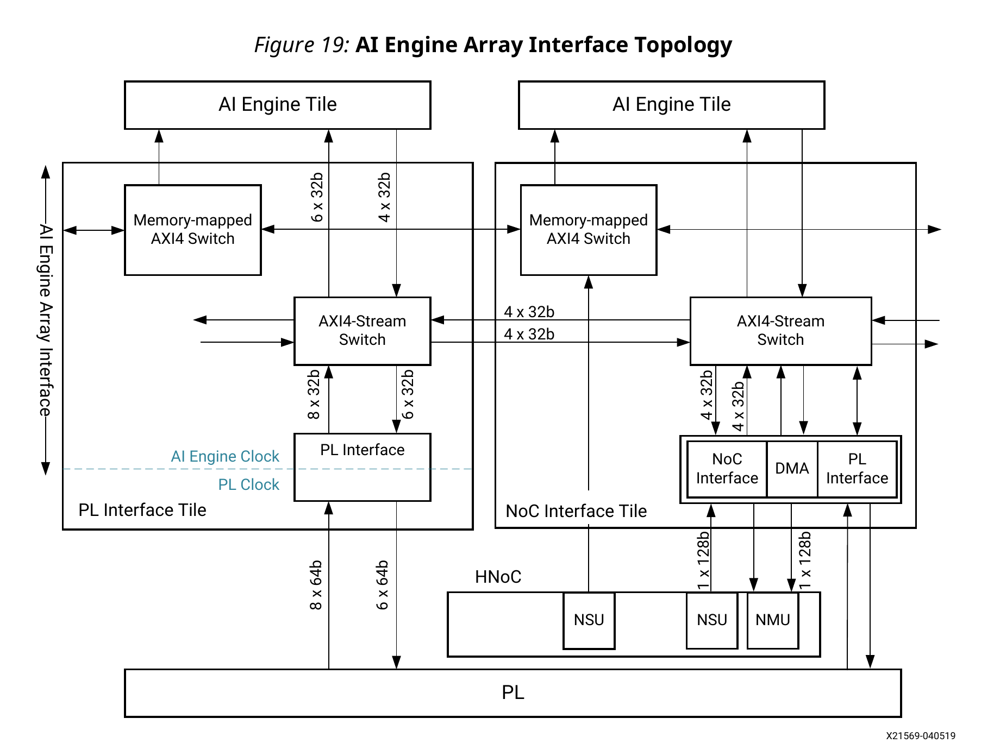

## Two Types of AXI4

- Slow, memory mapped AXI4 interconnect
  - Useful for config/debug
  - Send/recv data from PS
- Fast AXI4 streaming interconnect
  - Internal communication
  - DMA to non-neighbouring tiles
  - Direct streams (switched and packet)

## Two Types of AXI4

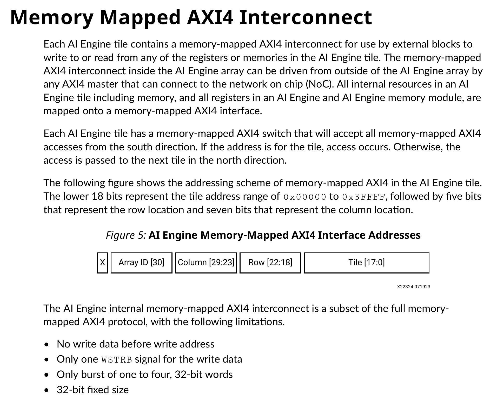

## Two Types of AXI4

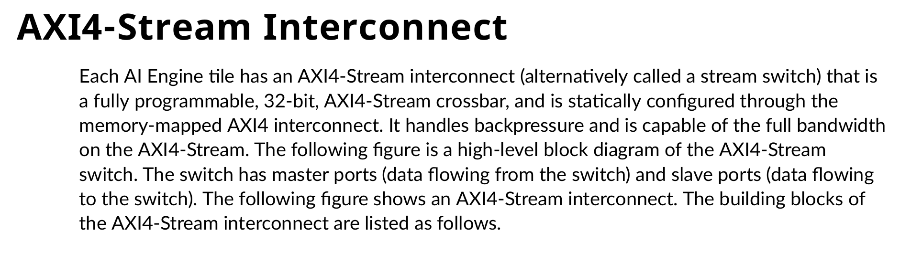

## Two Types of AXI4


::: { .column width="70%" }

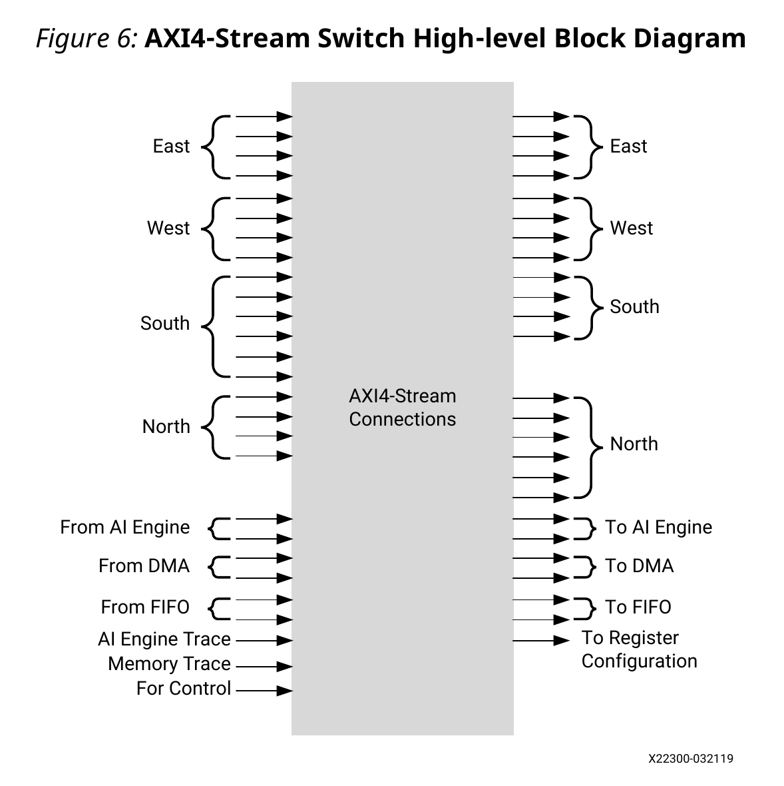

:::

## AIE Interfaces

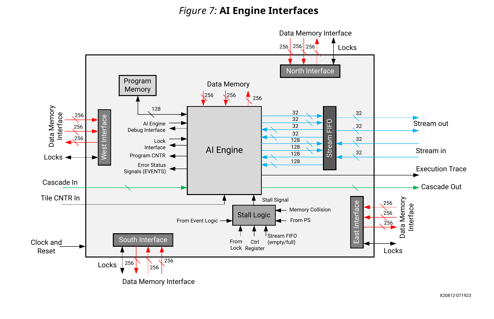

## Memory Module
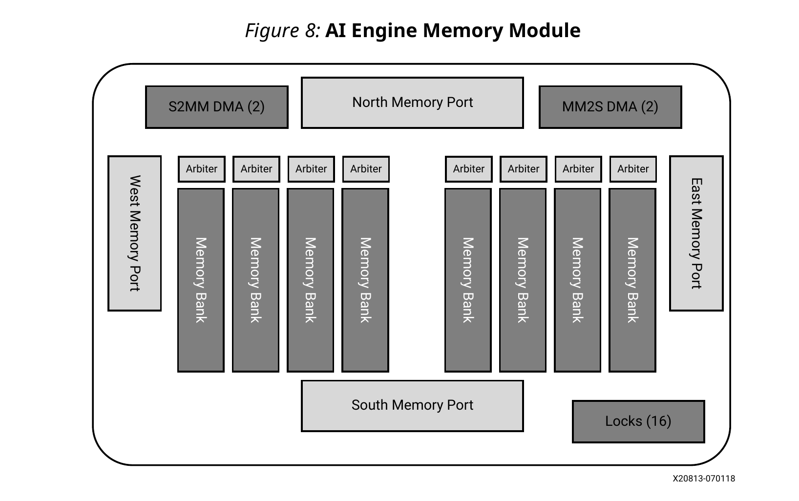

## Notes on Dropbear LSTM

- A basic stateful LSTM network with 4 gates.
- Reference C implementation:
  - State size = 100
  - Input size = 20
- In our design:
  - State size = 128
  - Input size = 32
- Extra space is filled with zero


## AIE LSTM Implementation

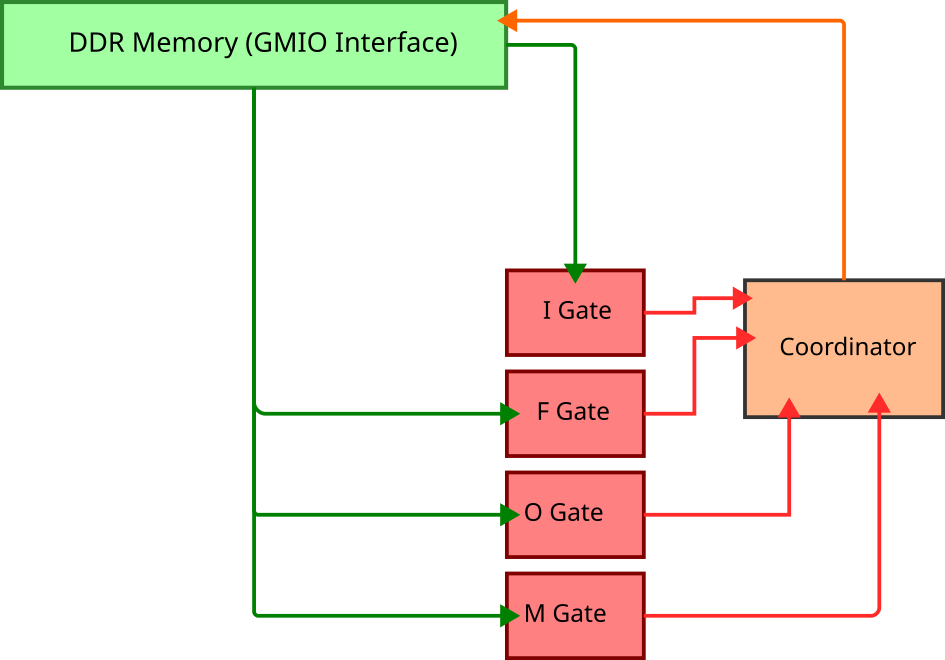


## Cost of a single "Full-gate"

::: incremental

- For convenience, let's ignore the cost of activation.
- Each gate does a matrix-vector multiplication.
  - Matrix dimension: $rows \times cols = 128 \times (128 + 32) = 128 \times 160$
  - Vector dimension: $128 \times 32 = 160$
  - Number of mults: $128 \times 160 = 20480$
  - Number of adds: $128 \times (160 - 1) = 20352$
  - Number of floating point MAC-s(approx): $20480$
- For four gates, total floating MAC-s(approx): $20480 \times 4 = 81920$ 

:::

## Variant 4X1\_BUFF

- Buffer interface
- 1 AIE Tile == 1 Full Gate
- 4 Full Gate + 1 Coordinator for activation
- 20480 MAC, per aie-tile, per iteration

~~~ {.dot filename="4x1_buff"}
digraph graph_4x1_buff {
  size = "32,24";

  IG_Full [shape=box,style=filled,color="blue",fontcolor="white"];
  FG_Full [shape=box,style=filled,color="blue",fontcolor="white"];
  MG_Full [shape=box,style=filled,color="blue",fontcolor="white"];
  OG_Full [shape=box,style=filled,color="blue",fontcolor="white"];

  Coord [shape=box,style=filled,color="gold3"];

  GMIO_In [style=filled,color="green",fontcolor="white"];
  GMIO_Out [style=filled,color="red",fontcolor="white"];

  IG_Full -> Coord [color="blue",label="[128]"];
  FG_Full -> Coord [color="blue",label="[128]"];
  MG_Full -> Coord [color="blue"label="[128]"];
  OG_Full -> Coord [color="blue"label="[128]"];

  Coord -> IG_Full [color="gold3",label="prev_state[128]"];
  Coord -> FG_Full [color="gold3",label="prev_state[128]"];
  Coord -> MG_Full [color="gold3",label="prev_state[128]"];
  Coord -> OG_Full [color="gold3",label="prev_state[128]"];

  GMIO_In -> IG_Full [color="green",label="input[32]"];
  GMIO_In -> FG_Full [color="green",label="input[32]"];
  GMIO_In -> MG_Full [color="green",label="input[32]"];
  GMIO_In -> OG_Full [color="green",label="input[32]"];

  Coord -> GMIO_Out [color="red",label="LSTM_output[4]"];
}
~~~


## Variant 4X2\_BUFF


- Buffer interface
- 1 AIE Tile == 1 Half Gate
- 8 Half gates + 1 coordinator
- 10240 MAC, per aie-tile, per iteration
- Horizontally divided

~~~ {.dot filename="4x2_buff"}
digraph graph_4x2_buff {
  size = "32,24";

  IG_Half_Up [shape=box,style=filled,color="blue",fontcolor="white"];
  FG_Half_Up [shape=box,style=filled,color="blue",fontcolor="white"];
  MG_Half_Up [shape=box,style=filled,color="blue",fontcolor="white"];
  OG_Half_Up [shape=box,style=filled,color="blue",fontcolor="white"];

  IG_Half_Down [shape=box,style=filled,color="blue2",fontcolor="white"];
  FG_Half_Down [shape=box,style=filled,color="blue2",fontcolor="white"];
  MG_Half_Down [shape=box,style=filled,color="blue2",fontcolor="white"];
  OG_Half_Down [shape=box,style=filled,color="blue2",fontcolor="white"];

  Coord [shape=box,style=filled,color="gold3"];

  GMIO_In [style=filled,color="green",fontcolor="white"];
  GMIO_Out [style=filled,color="red",fontcolor="white"];

  IG_Half_Up -> Coord [color="blue",label="[64]"];
  FG_Half_Up -> Coord [color="blue",label="[64]"];
  MG_Half_Up -> Coord [color="blue",label="[64]"];
  OG_Half_Up -> Coord [color="blue",label="[64]"];
  IG_Half_Down -> Coord [color="blue2",label="[64]"];
  FG_Half_Down -> Coord [color="blue2",label="[64]"];
  MG_Half_Down -> Coord [color="blue2",label="[64]"];
  OG_Half_Down -> Coord [color="blue2",label="[64]"];

  Coord -> IG_Half_Up [color="gold3",label="state[128]"];
  Coord -> FG_Half_Up [color="gold3",label="state[128]"];
  Coord -> MG_Half_Up [color="gold3",label="state[128]"];
  Coord -> OG_Half_Up [color="gold3",label="state[128]"];
  Coord -> IG_Half_Down [color="gold3",label="state[128]"];
  Coord -> FG_Half_Down [color="gold3",label="state[128]"];
  Coord -> MG_Half_Down [color="gold3",label="state[128]"];
  Coord -> OG_Half_Down [color="gold3",label="state[128]"];

  GMIO_In -> IG_Half_Up [color="green",label="input[32]"];
  GMIO_In -> FG_Half_Up [color="green",label="input[32]"];
  GMIO_In -> MG_Half_Up [color="green",label="input[32]"];
  GMIO_In -> OG_Half_Up [color="green",label="input[32]"];
  GMIO_In -> IG_Half_Down [color="green",label="input[32]"];
  GMIO_In -> FG_Half_Down [color="green",label="input[32]"];
  GMIO_In -> MG_Half_Down [color="green",label="input[32]"];
  GMIO_In -> OG_Half_Down [color="green",label="input[32]"];

  Coord -> GMIO_Out [color="gold3",label="[4]"];
}
~~~


## Variant 4X2\_STRM

- Stream interface
- 1 AIE Tile == 1 Half Gate
- 8 Half gates + 1 coordinator
- 10240 MAC, per aie-tile, per iteration
- Horizontally divided
- Both direct and packet switched streams used

``` {.dot filename="4x2_strm"}
digraph graph_4x2_strm {
  size = "32,24";

  IG_Half_Up [shape=box,style=filled,color="blue",fontcolor="white"];
  FG_Half_Up [shape=box,style=filled,color="blue",fontcolor="white"];
  MG_Half_Up [shape=box,style=filled,color="blue",fontcolor="white"];
  OG_Half_Up [shape=box,style=filled,color="blue",fontcolor="white"];

  IG_Half_Down [shape=box,style=filled,color="blue2",fontcolor="white"];
  FG_Half_Down [shape=box,style=filled,color="blue2",fontcolor="white"];
  MG_Half_Down [shape=box,style=filled,color="blue2",fontcolor="white"];
  OG_Half_Down [shape=box,style=filled,color="blue2",fontcolor="white"];

  Coord [shape=box,style=filled,color="gold3"];

  PacketStreamMux [shape=hexagon,style=filled,color="black",fontcolor="white"];

  GMIO_In [style=filled,color="green",fontcolor="white"];
  GMIO_Out [style=filled,color="red",fontcolor="white"];

  IG_Half_Up -> PacketStreamMux [color="blue",label="packet_strm"];
  FG_Half_Up -> PacketStreamMux [color="blue",label="packet_strm"];
  MG_Half_Up -> PacketStreamMux [color="blue",label="packet_strm"];
  OG_Half_Up -> PacketStreamMux [color="blue",label="packet_strm"];
  IG_Half_Down -> PacketStreamMux [color="blue2",label="packet_strm"];
  FG_Half_Down -> PacketStreamMux [color="blue2",label="packet_strm"];
  MG_Half_Down -> PacketStreamMux [color="blue2",label="packet_strm"];
  OG_Half_Down -> PacketStreamMux [color="blue2",label="packet_strm"];

  PacketStreamMux -> Coord [color="black",label="native_strm"];

  Coord -> IG_Half_Up [color="gold3",label="native_strm"];
  Coord -> FG_Half_Up [color="gold3",label="native_strm"];
  Coord -> MG_Half_Up [color="gold3",label="native_strm"];
  Coord -> OG_Half_Up [color="gold3",label="native_strm"];
  Coord -> IG_Half_Down [color="gold3",label="native_strm"];
  Coord -> FG_Half_Down [color="gold3",label="native_strm"];
  Coord -> MG_Half_Down [color="gold3",label="native_strm"];
  Coord -> OG_Half_Down [color="gold3",label="native_strm"];

  GMIO_In -> IG_Half_Up [color="green",label="native_strm"];
  GMIO_In -> FG_Half_Up [color="green",label="native_strm"];
  GMIO_In -> MG_Half_Up [color="green",label="native_strm"];
  GMIO_In -> OG_Half_Up [color="green",label="native_strm"];
  GMIO_In -> IG_Half_Down [color="green",label="native_strm"];
  GMIO_In -> FG_Half_Down [color="green",label="native_strm"];
  GMIO_In -> MG_Half_Down [color="green",label="native_strm"];
  GMIO_In -> OG_Half_Down [color="green",label="native_strm"];

  Coord -> GMIO_Out [color="gold3",label="[4]"];
}
```


## Experimental Setup

- In Priliminary testing, 4X2_BUFF was fastest
- 4X1_BUFF: ~25us / iteration
- 4X2_BUFF: ~17us / iteration
- 4X2_STRM: ~40us / iteration
- Choose to improve the loop in `gate_half_buff.cpp` kernel.
- All weights are stationary and updated using async RTP.


## Source Structure

``` {.terminal}
titon@lelu:.../amd_ai_engine/aie_lstm$ tree src/
src/
├── common_defs.hpp
├── data
│   ├── dropbear.hpp
│   └── weights.hpp
├── data_reader.hpp
├── graphs.hpp
├── kernels
│   ├── activation_funcs
│   │   ├── sigm_approx.hpp
│   │   ├── sigm_pwl.hpp
│   │   ├── sigm_soft.hpp
│   │   ├── tanh_approx.hpp
│   │   ├── tanh_pwl.hpp
│   │   └── tanh_soft.hpp
│   ├── coordinator_4x1_buff.cpp
│   ├── coordinator_4x2_buff.cpp
│   ├── coordinator_4x2_strm.cpp
│   ├── gate_full_buff.cpp
│   ├── gate_half_buff.cpp
│   ├── gate_half_strm.cpp
│   ├── kernel_lib.hpp
│   ├── kernels.hpp
│   └── utils.hpp
└── main.cpp

4 directories, 21 files

```

## Loop structure

~~~ {#large-code-block .cpp}

#include "kernel_lib.hpp"
#include <aie_api/aie.hpp>
#include <aie_api/aie_adf.hpp>
#include <aie_api/utils.hpp>

using namespace aie;

void gate_half_buff(
    // Input buffers.
    adf::input_buffer<float, adf::extents<INPUT_DIM>> &__restrict input,
    adf::input_buffer<float, adf::extents<LSTM_UNITS>> &__restrict state,

    // Run Time Parameters.
    const float (&w_state_part)[W_STATE_SIZE / 2],
    const float (&w_input)[W_INPUT_SIZE],
    const float (&bias)[LSTM_UNITS / 2],
    const int partial_computation,

    // Output buffers.
    adf::output_buffer<float, adf::extents<LSTM_UNITS / 2>> &__restrict output) {

    // Set C compatible rounding mode.
    set_rounding(aie::rounding_mode::conv_even);

#if defined(GATE_HALF_LOOP_V6) || defined(GATE_HALF_LOOP_V7) || defined(GATE_HALF_LOOP_V8)
    // Setup circular iterators for input, output and state buffers.
    const vector<float, VECTOR_LANES> *__restrict inp_p = (const vector<float, VECTOR_LANES> *)input.data();
    const vector<float, VECTOR_LANES> *__restrict state_p = (const vector<float, VECTOR_LANES> *)state.data();
    vector<float, VECTOR_LANES> *__restrict outp_p = (vector<float, VECTOR_LANES> *)output.data();

    const vector<float, VECTOR_LANES> *__restrict w_state_p = (const vector<float, VECTOR_LANES> *)w_state_part;
    const vector<float, VECTOR_LANES> *__restrict w_inp_p = (const vector<float, VECTOR_LANES> *)w_input;
    const vector<float, VECTOR_LANES> *__restrict bias_p = (const vector<float, VECTOR_LANES> *)bias;
#else
    // Setup iterators for input, output and state buffers. Since
    // buffers already declared 'restrict', we don't need to use
    // restrict-variant iterators.
    auto inp_iter = cbegin_vector<VECTOR_LANES>(input);
    auto state_iter = cbegin_vector<VECTOR_LANES>(state);
    auto out_iter = begin_vector<VECTOR_LANES>(output);

    // Setup iterators for weights and bias run time parameters.
    auto w_inp_iter = cbegin_restrict_vector<VECTOR_LANES>(w_input);
    auto w_state_iter = cbegin_restrict_vector<VECTOR_LANES>(w_state_part);
    auto b_iter = cbegin_restrict_vector<VECTOR_LANES>(bias);
#endif

    float sum1, sum2, rslt;
    vector<float, VECTOR_LANES> va, vb, vc, vd, rslt_v;

    // NOTE: The reason for using two accumulators is to fill the
    // pipeline during the two idle cycles of float MACS, as
    // described in UG1079(v2024.1), Ch 3, Sec "Floating Point
    // Operations", page 54.
    accum<accfloat, VECTOR_LANES> acc1, acc2;

    constexpr int input_blocks = INPUT_DIM / VECTOR_LANES;
    constexpr int state_blocks = W_STATE_COLS / VECTOR_LANES;

    // Record cycle count before the loop.
    auto n_cycles_before = get_cycles();

#if defined(GATE_HALF_LOOP_V1)
...
...
#elif defined(GATE_HALF_LOOP_V4)
...
...
#endif
    auto n_cycles_after = get_cycles();
    auto cycle_count = n_cycles_after - n_cycles_before;
    printf("Loop cycle count: %llu\n", cycle_count);
}
~~~

## Testing

- X86simulator for functional correctness.
- aisimulator for cycle approximate timing.
- X86simulator should match aiesimulator
- Otherwise, there is timing bug
- Cycle count with `get_cycles()` call
- Trace from vcddump


## Matrix Vector Mult

::: {.column width="70%" }

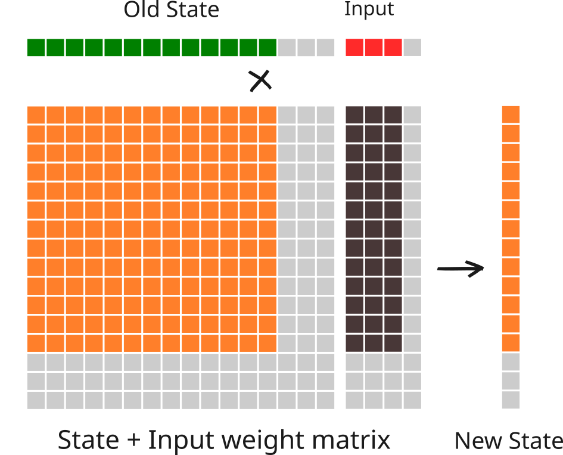

:::


## Matrix Vector Mult

::: {.column width="70%" }

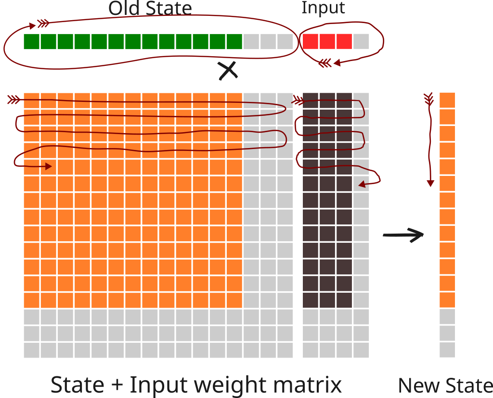

:::
