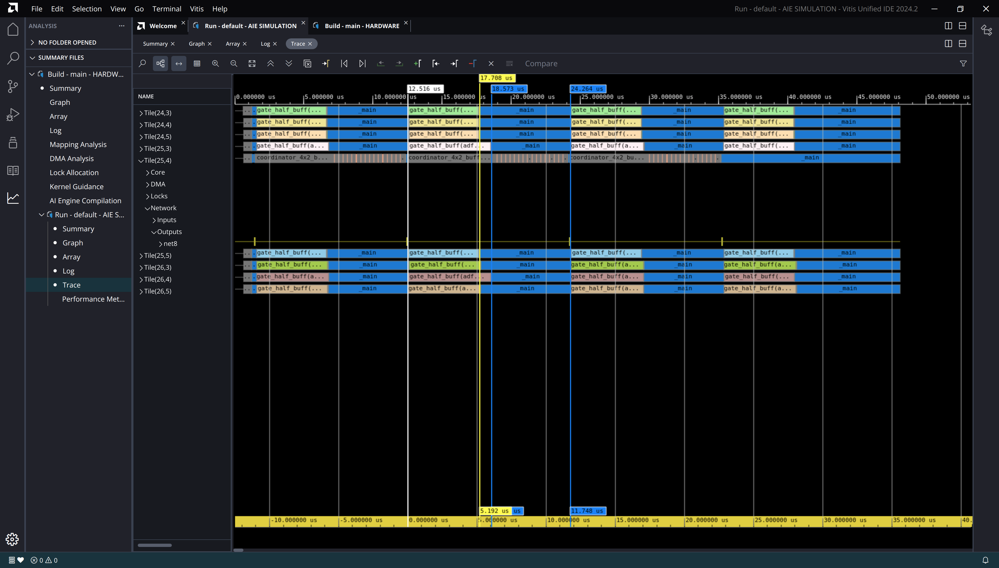

-----------------

# Loop V2


## Loop V2

:::::::::::::: {.columns}
::: {.column width="60%"}

~~~ { #large-code-block .cpp}
...
#elif defined(GATE_HALF_LOOP_V2)
    // - pipelining at outer-most loop
    // - branch to skip invalid computation REMOVED
    // - branch to seperate result block
    // - single accumulator
    rslt_v = zeros<float, VECTOR_LANES>();
    for (int row = 0; row < LSTM_UNITS / 2; row++)
        chess_prepare_for_pipelining {
            acc1 = zeros<accfloat, VECTOR_LANES>();

            // Multiply and accumulate with state weight matrix.
            for (int i = 0; i < state_blocks; i++) {
                va = *w_state_iter++;
                vb = *state_iter++;
                acc1 = mac(acc1, va, vb);
            }

            // Mutiply and accumulate with input-weight matrix.
            for (int i = 0; i < input_blocks; i++) {
                va = *w_inp_iter++;
                vb = *inp_iter++;
                acc1 = mac(acc1, va, vb);
            }

            // Sum all of the accumulator lanes.
            rslt = reduce_add(acc1.to_vector<float>(0));

            // Push the result scalar into the vector.
            rslt_v.push(rslt);

            // If result vector is full, publish it to output.
            if ((row % VECTOR_LANES) == (VECTOR_LANES - 1)) {
                rslt_v = reverse(rslt_v);
                // Add bias to generate one block of gate results.
                rslt_v = add(*b_iter++, rslt_v);
                *out_iter++ = rslt_v;
            }

            // Reset input and state iterators.
            state_iter -= state_blocks;
            inp_iter -= input_blocks;
        }
...
~~~

:::

::: {.column width="40%"}

- Invalid computation skipping removed
- Pipelining still fails

:::

::::::::::::::


---

## Cycle count

```
Loop cycle count: 6317
Loop cycle count: 6317
Loop cycle count: 6317
Loop cycle count: 6317
Loop cycle count: 6404
Loop cycle count: 6415
Loop cycle count: 6481
Loop cycle count: 6485
```

| Loop | Min | Max | Avg | Std |
|------|-----|-----|-----|-----|
| loop_v1 | 5221 | 8086 | 6327.9 | 1057.8 |
| loop_v2 | 6317 | 6525 | 6392.0 | 86.2 |

---


## Performance Analysis

- Simulation AIE clock speed: 1.25GHz
- Avg. time taken (nsec): $t = 6392.9 / 1.25$
- Avg. performance per gate (GMAC/s): $P = 10240 / t = 2.00$
- Theoretical maximum: 8 GMAC/s
- Percent core utilization: 25.00%
- Slightly less than v1, which is expected.

## Report

- [Kernel compilation log](results/loop_v2/24_4.log)
- [Simulator log](results/loop_v2/AIESimulator.log)
- [Micro-code listing](results/loop_v2/gate_half_buff.o.lst)
- [Report dir](results/loop_v2/)


## Trace

