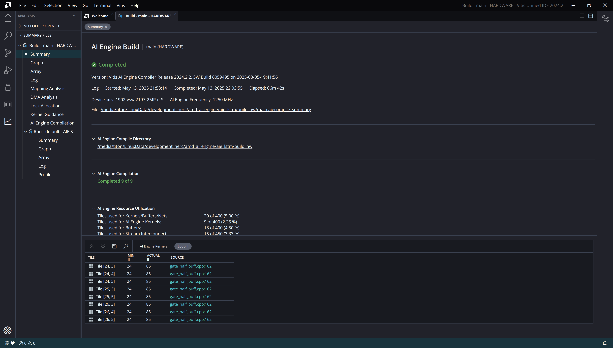
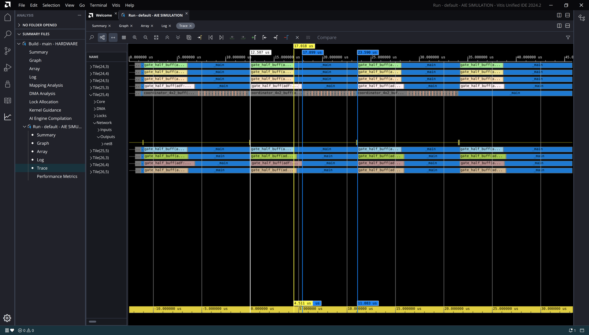

-----------------

# Loop V3


## Loop V3

:::::::::::::: {.columns}
::: {.column width="60%"}

~~~ { #large-code-block .cpp}
...
#elif defined(GATE_HALF_LOOP_V3)
    // - pipelining at outer-most loop
    // - branch to seperate result-block REMOVED as a static loop
    // - single accumulator
    constexpr int row_block_size = VECTOR_LANES;
    constexpr int n_row_blocks = LSTM_UNITS / 2 / row_block_size;

    for (int row_block = 0; row_block < n_row_blocks; row_block++)
        chess_prepare_for_pipelining {

            // Compute a block of rows.
            for (int row = 0; row < row_block_size; row++) {
                acc1 = zeros<accfloat, VECTOR_LANES>();

                // Multiply and accumulate with state weight matrix.
                for (int i = 0; i < state_blocks; i++) {
                    va = *w_state_iter++;
                    vb = *state_iter++;
                    acc1 = mac(acc1, va, vb);
                }

                // Mutiply and accumulate with input-weight matrix.
                for (int i = 0; i < input_blocks; i++) {
                    va = *w_inp_iter++;
                    vb = *inp_iter++;
                    acc1 = mac(acc1, va, vb);
                }

                // Sum all of the accumulator lanes.
                rslt = reduce_add(acc1.to_vector<float>(0));

                // Place the result scalar into the vector.
                rslt_v.push(rslt);

                // Reset input and state iterators.
                state_iter -= state_blocks;
                inp_iter -= input_blocks;
            }

            rslt_v = reverse(rslt_v);
            // Add bias.
            rslt_v = add(*b_iter, rslt_v);
            // Forward gate output to coordinator.
            *out_iter = rslt_v;

            b_iter++;
            out_iter++;
        }
...
~~~

:::

::: {.column width="40%"}

- All conditionals removed
- New block lvl loop
- Soft-pipelining successful

:::

::::::::::::::


---

## Cycle count

```
Loop cycle count: 5535
Loop cycle count: 5535
Loop cycle count: 5535
Loop cycle count: 5535
Loop cycle count: 5606
Loop cycle count: 5606
Loop cycle count: 6470
Loop cycle count: 6473
```

| Loop | Min | Max | Avg | Std |
|------|-----|-----|-----|-----|
| loop_v1 | 5221 | 8086 | 6327.9 | 1057.8 |
| loop_v2 | 6317 | 6525 | 6392.0 | 86.2 |
| loop_v3 | 5535 | 6473 | 5677.2 | 241.6 |

---


## Loop Scheduling Log

~~~ {#large-code-block}
...
Scheduling basic blocks ...

HW do-loop #2128 in "/media/titon/LinuxData/development_herc/amd_ai_engine/aie_lstm/src/kernels/gate_half_buff.cpp", line 162: (loop #8) :
critical cycle of length 69 : b105 -> b144 -> b110 -> b146 -> b111 -> b147 -> b148 -> b115 -> b149 -> b150 -> b119 -> b151 -> b152 -> b123 -> b153 -> b154 -> b127 -> b155 -> b156 -> b131 -> b157 -> b158 -> b135 -> b105
minimum length due to resources: 24
scheduling HW do-loop #2128     	-> # cycles: 127 
  -> HW do-loop #2128 in "/media/titon/LinuxPortable/xilinx_tools_2024_2/Vitis/2024.2/aietools/include/aie_api/detail/aie1/vector.hpp", line 308: (loop #8) : 127 cycles
scheduling macro #2417     	-> # cycles: 2 
scheduling macro #2409     	-> # cycles: 16 
scheduling macro #55     	-> # cycles: 6 
scheduling macro #57     	-> # cycles: 1 
scheduling macro #59     	-> # cycles: 15 
scheduling macro #2153     	-> # cycles: 2 
scheduling macro #216     	-> # cycles: 1 
scheduling macro #286     	-> # cycles: 11 
scheduling macro #226     	-> # cycles: 17 

Total number of cycles = 198
...
...
review chess_separator_scheduler(offset > 0)
removing chess_separator blocks up to strength 2 in foldable loops

HW do-loop #2128 in "/media/titon/LinuxData/development_herc/amd_ai_engine/aie_lstm/src/kernels/gate_half_buff.cpp", line 162: (loop #8) :
critical cycle of length 85 : b107 -> b145 -> b111 -> b147 -> b115 -> b149 -> b119 -> b151 -> b123 -> b153 -> b127 -> b155 -> b131 -> b157 -> b158 -> b160 -> b161 -> b140 -> b163 -> b164 -> b424 -> b165 -> b425 -> b166 -> b426 -> b167 -> b168 -> b107
minimum length due to resources: 24
scheduling HW do-loop #2128
(algo 1a)	-> # cycles: 95 
(modulo)	-> # cycles: 85 ok (required budget ratio: 1)  
(resume algo)	  -> after folding: 85  (folded over 1 iterations)
  -> HW do-loop #2128 in "/media/titon/LinuxPortable/xilinx_tools_2024_2/Vitis/2024.2/aietools/include/aie_api/detail/aie1/vector.hpp", line 308: (loop #8) : 85 cycles
NOTICE: postamble created
removing chess_separator blocks up to strength 2 (all)

Constructing flow graphs ...

Software pipelining non-leaf loop in "/media/titon/LinuxData/development_herc/amd_ai_engine/aie_lstm/src/kernels/gate_half_buff.cpp", line 158: (loop #3):
Schedule merged head/tail blocks macro #2422:
[0]: no folding (max fi=0):
scheduling macro #2422     	-> # cycles: 106 
[1]: no folding to next iteration (max fi=1), no postamble:
scheduling macro #2422     	-> # cycles: 106 
[2]: no folding to next iteration (max fi=1), allow postamble:
scheduling macro #2422     	-> # cycles: 94 
[3]: no folding to prev iteration (max fi=1):
scheduling macro #2422     	-> # cycles: 94 
[4]: unrestricted folding (max fi=2):
scheduling macro #2422     	-> # cycles: 94 
==> Selected [2] (# cycles=94, max fi=1)

NOTICE: You can override selected solution with chess_pipeline_non_leaf_loop_solution(N).
NOTICE: loop #5 contains folded negative edges
NOTICE: postamble created

jump threading ...
adding manifest flow nodes ...

Constructing flow graphs ...
Scheduling basic blocks ...
scheduling macro #2419     	-> # cycles: 73 
scheduling macro #2409     	-> # cycles: 21 
scheduling macro #2426     	-> # cycles: 15 
scheduling macro #2430     	-> # cycles: 73 
scheduling macro #55     	-> # cycles: 9 
scheduling macro #57     	-> # cycles: 4 
scheduling macro #2153     	-> # cycles: 21 
scheduling macro #216     	-> # cycles: 5 
scheduling macro #286     	-> # cycles: 7 
scheduling macro #226     	-> # cycles: 17 

Total number of cycles = 415

Checking data/anti-dependencies beyond basic block boundaries
Checking resource conflicts beyond basic block boundaries
Checking pipeline hazards ...

Instruction alignment adds 88 extra words
Filling in loop counts in instruction enabling ...
Re-filling in 'a', 'r' values in instruction enabling ...
Adjusting target addresses ...
...
~~~

## Loop II



## Performance Analysis

- Simulation AIE clock speed: 1.25GHz
- Avg. time taken (nsec): $t = 5677.2 / 1.25$
- Avg. performance per gate (GMAC/s): $P = 10240 / t = 2.25$
- Theoretical maximum: 8 GMAC/s
- Percent core utilization: 28.18%

## Report

- [Kernel compilation log](results/loop_v3/24_4.log)
- [Simulator log](results/loop_v3/AIESimulator.log)
- [Micro-code listing](results/loop_v3/gate_half_buff.o.lst)
- [Report dir](results/loop_v3/)


## Trace

