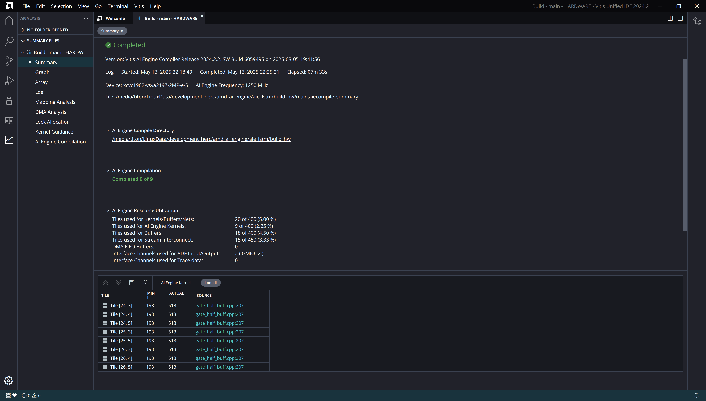
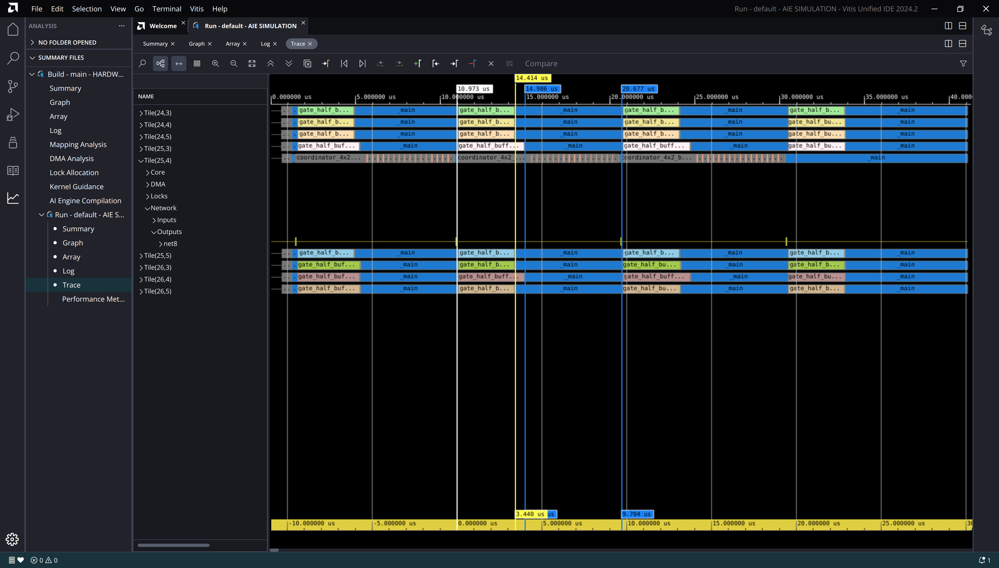

-----------------

# Loop V4

## Loop V4

:::::::::::::: {.columns}
::: {.column width="60%"}

~~~ { #large-code-block .cpp}
...
#elif defined(GATE_HALF_LOOP_V4)
    // - pipelining at outer-most loop
    // - all inner loops flatten-ed
    // - single accumulator
    // - NOTE: This is the best one so far, with 4125 cycles.
    constexpr int row_block_size = VECTOR_LANES;
    constexpr int n_row_blocks = LSTM_UNITS / 2 / row_block_size;

    for (int row_block = 0; row_block < n_row_blocks; row_block++)
        chess_prepare_for_pipelining {

            // Compute a block of rows.
            for (int row = 0; row < row_block_size; row++)
                chess_flatten_loop {
                    acc1 = zeros<accfloat, VECTOR_LANES>();

                    // Multiply and accumulate with state weight matrix.
                    for (int i = 0; i < state_blocks; i++)
                        chess_flatten_loop {
                            va = *w_state_iter++;
                            vb = *state_iter++;
                            acc1 = mac(acc1, va, vb);
                        }

                    // Mutiply and accumulate with input-weight matrix.
                    for (int i = 0; i < input_blocks; i++)
                        chess_flatten_loop {
                            va = *w_inp_iter++;
                            vb = *inp_iter++;
                            acc1 = mac(acc1, va, vb);
                        }

                    // Sum all of the accumulator lanes.
                    rslt = reduce_add(acc1.to_vector<float>(0));

                    // Place the result scalar into the vector.
                    rslt_v.push(rslt);

                    // Reset input and state iterators.
                    state_iter -= state_blocks;
                    inp_iter -= input_blocks;
                }

            rslt_v = reverse(rslt_v);
            // Add bias.
            rslt_v = add(*b_iter, rslt_v);
            // Forward gate output to coordinator.
            *out_iter = rslt_v;

            b_iter++;
            out_iter++;
        }
...
~~~

:::

::: {.column width="40%"}

- Pipelining at outer loop
- Middle and innermost loops flattened

:::

::::::::::::::

---

## Cycle count (Page 1)

~~~
Loop cycle count: 4127
Loop cycle count: 4124
Loop cycle count: 4124
Loop cycle count: 4133
Loop cycle count: 4535
Loop cycle count: 4547
Loop cycle count: 4564
Loop cycle count: 4573

~~~

-----

## Cycle count (Page 2)

| Loop | Min | Max | Avg | Std |
|------|-----|-----|-----|-----|
| loop_v1 | 5221 | 8086 | 6327.9 | 1057.8 |
| loop_v2 | 6317 | 6525 | 6392.0 | 86.2 |
| loop_v3 | 5535 | 6473 | 5677.2 | 241.6 |
| loop_v4 | 4124 | 4854 | 4278.9 | 247.2 |

-----

## Loop Scheduling Log

~~~ {#large-code-block}
...
Constructing flow graphs ...
Scheduling basic blocks ...

HW do-loop #885 in "/media/titon/LinuxData/development_herc/amd_ai_engine/aie_lstm/src/kernels/gate_half_buff.cpp", line 216: (loop #13) :
critical cycle of length 2 : b128 -> b128
scheduling HW do-loop #885     	-> # cycles: 8 
  -> HW do-loop #885 in "/media/titon/LinuxPortable/xilinx_tools_2024_2/Vitis/2024.2/aietools/include/aie_api/detail/aie1/mul_acc32_fp.hpp", line 41: (loop #13) : 8 cycles

HW do-loop #909 in "/media/titon/LinuxData/development_herc/amd_ai_engine/aie_lstm/src/kernels/gate_half_buff.cpp", line 224: (loop #25) :
critical cycle of length 2 : b125 -> b125
scheduling HW do-loop #909     	-> # cycles: 8 
  -> HW do-loop #909 in "/media/titon/LinuxPortable/xilinx_tools_2024_2/Vitis/2024.2/aietools/include/aie_api/detail/aie1/mul_acc32_fp.hpp", line 41: (loop #25) : 8 cycles
scheduling macro #1076     	-> # cycles: 28 
scheduling macro #1090     	-> # cycles: 11 
scheduling macro #79     	-> # cycles: 8 
scheduling macro #81     	-> # cycles: 1 
scheduling macro #83     	-> # cycles: 16 
scheduling macro #1101     	-> # cycles: 2 
scheduling macro #134     	-> # cycles: 3 
scheduling macro #222     	-> # cycles: 11 
scheduling macro #144     	-> # cycles: 17 

Total number of cycles = 113

Checking data/anti-dependencies beyond basic block boundaries

...
...
Compiling all mappings: 0%..10%..20%..30%..40%..50%..60%..70%..80%..90%..100%

flatten loops : #25 #13 #8
review chess_separator_scheduler(offset > 0)
removing chess_separator blocks up to strength 2 in foldable loops

HW do-loop #885 in "/media/titon/LinuxData/development_herc/amd_ai_engine/aie_lstm/src/kernels/gate_half_buff.cpp", line 207: (loop #3) :
critical cycle of length 306 : b122 -> b910 -> b963 -> b917 -> b920 -> b923 -> b926 -> b929 -> b932 -> b935 -> b938 -> b941 -> b944 -> b947 -> b950 -> b953 -> b956 -> b959 -> b962 -> b966 -> b969 -> b972 -> b975 -> b983 -> b978 -> b984 -> b979 -> b985 -> b980 -> b981 -> b1034 -> b988 -> b991 -> b994 -> b997 -> b1000 -> b1003 -> b1006 -> b1009 -> b1012 -> b1015 -> b1018 -> b1021 -> b1024 -> b1027 -> b1030 -> b1033 -> b1037 -> b1040 -> b1043 -> b1046 -> b1054 -> b1049 -> b1055 -> b1050 -> b1056 -> b1051 -> b1052 -> b1105 -> b1059 -> b1062 -> b1065 -> b1068 -> b1071 -> b1074 -> b1077 -> b1080 -> b1083 -> b1086 -> b1089 -> b1092 -> b1095 -> b1098 -> b1101 -> b1104 -> b1108 -> b1111 -> b1114 -> b1117 -> b1125 -> b1120 -> b1126 -> b1121 -> b1127 -> b1122 -> b1123 -> b1176 -> b1130 -> b1133 -> b1136 -> b1139 -> b1142 -> b1145 -> b1148 -> b1151 -> b1154 -> b1157 -> b1160 -> b1163 -> b1166 -> b1169 -> b1172 -> b1175 -> b1179 -> b1182 -> b1185 -> b1188 -> b1196 -> b1191 -> b1197 -> b1192 -> b1198 -> b1193 -> b1194 -> b1247 -> b1201 -> b1204 -> b1207 -> b1210 -> b1213 -> b1216 -> b1219 -> b1222 -> b1225 -> b1228 -> b1231 -> b1234 -> b1237 -> b1240 -> b1243 -> b1246 -> b1250 -> b1253 -> b1256 -> b1259 -> b1267 -> b1262 -> b1268 -> b1263 -> b1269 -> b1264 -> b1318 -> b1272 -> b1275 -> b1278 -> b1281 -> b1284 -> b1287 -> b1290 -> b1293 -> b1296 -> b1299 -> b1302 -> b1305 -> b1308 -> b1311 -> b1314 -> b1317 -> b1321 -> b1324 -> b1327 -> b1330 -> b1338 -> b1333 -> b1339 -> b1334 -> b1340 -> b1335 -> b1336 -> b1337 -> b111 -> b112 -> b113 -> b114 -> b122
minimum length due to resources: 193
scheduling HW do-loop #885
(algo 2)	-> # cycles: 526 
(modulo)	-> # cycles: 306c 307c 308c 309c 310c 311c 312c 313c 314c 315c 316c 317c 318c 319c 320c 321c 322c 323c 324c 325c 326c 327c 328c 329c 330c 331c 332c 333c 334c 335c 336c 337c 338c 339c 340c 341c 342c 343c 344c 345c 346c 347c 348c 349c 350c 351c 352c 353c 354c 355c 356c 357c 358c 359c 360c 361c 362c 363c 364c 365c 366c 367c 368c 369c 370c 371c 372c 373c 374c 375c 376c 377c 378c 379c 380c 381c 382c 383c 384c 385c 386c 387c 388c 389c 390c 391c 392c 393c 394c 395c 396c 397c 398c 399c 400c 401c 402c 403c 404c 405c 406c 407c 408c 409c 410c 411c 412c 413c 414c 415c 416c 417c 418c 419c 420c 421c 422c 423c 424c 425c 426c 427c 428c 429c 430c 431c 432c 433c 434c 435c 436c 437c 438c 439c 440c 441c 442c 443c 444c 445c 446c 447c 448c 449c 450c 451c 452c 453c 454c 455c 456c 457c 458c 459c 460c 461c 462c 463c 464c 465c 466c 467c 468c 469c 470c 471c 472c 473c 474c 475c 476c 477c 478c 479c 480c 481c 482c 483c 484c 485c 486c 487c 488c 489c 490c 491c 492c 493c 494c 495c 496c 497c 498c 499c 500c 501c 502c 503c 504c 505c 506c 507c 508c 509c 510c 511c 512c 513 ok 512c (required budget ratio: 1)  
(resume algo)	  -> after folding: 513  (folded over 1 iterations)
  -> HW do-loop #885 in "/media/titon/LinuxPortable/xilinx_tools_2024_2/Vitis/2024.2/aietools/include/aie_api/detail/aie1/mul_acc32_fp.hpp", line 41: (loop #3) : 513 cycles
NOTICE: postamble created
removing chess_separator blocks up to strength 2 (all)

jump threading ...
adding manifest flow nodes ...

Constructing flow graphs ...
Scheduling basic blocks ...
scheduling macro #79     	-> # cycles: 6 
scheduling macro #81     	-> # cycles: 4 
scheduling macro #1134     	-> # cycles: 515 
scheduling macro #1101     	-> # cycles: 13 
scheduling macro #134     	-> # cycles: 5 
scheduling macro #222     	-> # cycles: 7 
scheduling macro #144     	-> # cycles: 17 

Total number of cycles = 1080

Checking data/anti-dependencies beyond basic block boundaries
Checking resource conflicts beyond basic block boundaries
Checking pipeline hazards ...

Instruction alignment adds 28 extra words
Filling in loop counts in instruction enabling ...
Re-filling in 'a', 'r' values in instruction enabling ...
Adjusting target addresses ...
...
~~~

## Loop II

## Performance Analysis

- Simulation AIE clock speed: 1.25GHz
- Avg. time taken (nsec): $t = 4278.2 / 1.25$
- Avg. performance per gate (GMAC/s): $P = 10240 / t = 2.99$
- Theoretical maximum: 8 GMAC/s
- Percent core utilization: 37.38%

## Report

- [Kernel compilation log](results/loop_v4/24_4.log)
- [Simulator log](results/loop_v4/AIESimulator.log)
- [Micro-code listing](results/loop_v4/gate_half_buff.o.lst)
- [Report dir](results/loop_v4/)

## Trace

