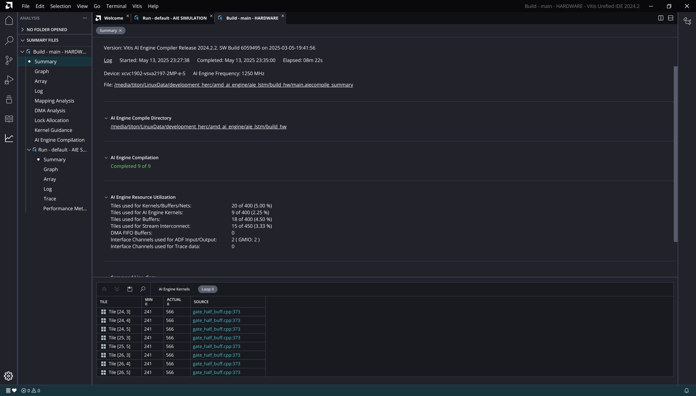
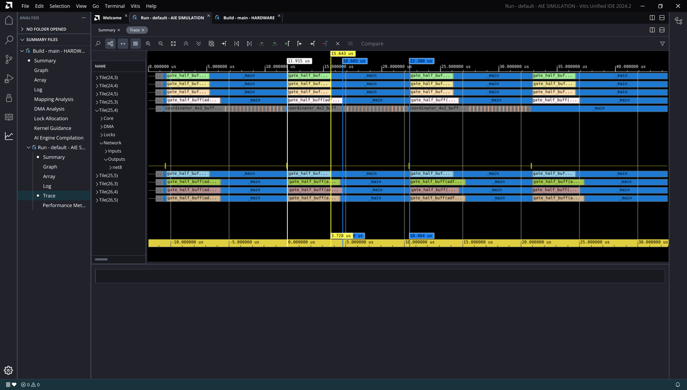

-----------------

# Loop V7

## Loop V7

:::::::::::::: {.columns}
::: {.column width="60%"}

~~~ { #large-code-block .cpp}
...
#elif defined(GATE_HALF_LOOP_V7)
    // - used pointers instead of iterators
    // - pipelining at outer loop
    // - inner loops completely flattened
    // - double accumulator
    // - NOTE: min cycle count = 3670 !!!
    constexpr int row_block_size = VECTOR_LANES;
    constexpr int n_row_blocks = LSTM_UNITS / 2 / row_block_size;
    constexpr int n_state_blocks = W_STATE_COLS / VECTOR_LANES;
    constexpr int n_input_blocks = INPUT_DIM / VECTOR_LANES;

    for (int row_block = 0; row_block < n_row_blocks; row_block++)
        chess_prepare_for_pipelining {
            // Compute a block of rows.
            for (int row = 0; row < row_block_size; row++)
                chess_flatten_loop {
                    acc1 = zeros<accfloat, VECTOR_LANES>();
                    acc2 = zeros<accfloat, VECTOR_LANES>();

                    // Multiply and accumulate with state weight matrix.
                    for (int i = 0; i < n_state_blocks / 2; i++)
                        chess_flatten_loop {
                            va = *w_state_p++;
                            vb = *state_p++;
                            acc1 = mac(acc1, va, vb);

                            vc = *w_state_p++;
                            vd = *state_p++;
                            acc2 = mac(acc2, vc, vd);
                        }

                    // Mutiply and accumulate with input-weight matrix.
                    for (int i = 0; i < n_input_blocks / 2; i++)
                        chess_flatten_loop {
                            va = *w_inp_p++;
                            vb = *inp_p++;
                            acc1 = mac(acc1, va, vb);

                            vc = *w_inp_p++;
                            vd = *inp_p++;
                            acc2 = mac(acc2, vc, vd);
                        }

                    // Sum all of the accumulator lanes.
                    rslt = reduce_add(acc1.to_vector<float>(0));
                    rslt += reduce_add(acc2.to_vector<float>(0));

                    // Place the result scalar into the vector.
                    rslt_v.push(rslt);

                    // Reset state and input pointers.
                    state_p -= n_state_blocks;
                    inp_p -= n_input_blocks;
                }

            rslt_v = reverse(rslt_v);
            // Add bias.
            rslt_v = add(*bias_p++, rslt_v);
            // Forward gate output to coordinator.
            *outp_p++ = rslt_v;
        }
...
~~~

:::

::: {.column width="40%"}

- Use of pointers instead of iterators
- Pipelining at outer loop
- All inner loops flattened
- Double accumulator

:::

::::::::::::::

---

## Cycle count (Page 1)

~~~
Loop cycle count: 4549
Loop cycle count: 4546
Loop cycle count: 4549
Loop cycle count: 4558
Loop cycle count: 5708
Loop cycle count: 5715
Loop cycle count: 5731
Loop cycle count: 5733
~~~

-----

## Cycle count (Page 2)

| Loop | Min | Max | Avg | Std |
|------|-----|-----|-----|-----|
| loop_v1 | 5221 | 8086 | 6327.9 | 1057.8 |
| loop_v2 | 6317 | 6525 | 6392.0 | 86.2 |
| loop_v3 | 5535 | 6473 | 5677.2 | 241.6 |
| loop_v4 | 4124 | 4854 | 4278.9 | 247.2 |
| loop_v5 | 4546 | 5900 | 5056.2 | 554.1 |
| loop_v6 | 4124 | 4854 | 4278.9 | 247.2 |
| loop_v7 | 4546 | 5900 | 5056.2 | 554.1 |
-----

## Loop Scheduling Log

~~~ {#large-code-block}
...
Scheduling basic blocks ...

HW do-loop #961 in "/media/titon/LinuxData/development_herc/amd_ai_engine/aie_lstm/src/kernels/gate_half_buff.cpp", line 382: (loop #13) :
critical cycle of length 8 : b139 -> b143 -> b141 -> b139
minimum length due to resources: 2
scheduling HW do-loop #961     	-> # cycles: 15 
  -> HW do-loop #961 in "/media/titon/LinuxPortable/xilinx_tools_2024_2/Vitis/2024.2/aietools/include/aie_api/detail/aie1/mul_acc32_fp.hpp", line 41: (loop #13) : 15 cycles

HW do-loop #1007 in "/media/titon/LinuxData/development_herc/amd_ai_engine/aie_lstm/src/kernels/gate_half_buff.cpp", line 394: (loop #25) :
critical cycle of length 8 : b133 -> b137 -> b135 -> b133
minimum length due to resources: 2
scheduling HW do-loop #1007     	-> # cycles: 15 
  -> HW do-loop #1007 in "/media/titon/LinuxPortable/xilinx_tools_2024_2/Vitis/2024.2/aietools/include/aie_api/detail/aie1/mul_acc32_fp.hpp", line 41: (loop #25) : 15 cycles
scheduling macro #1261     	-> # cycles: 57 
scheduling macro #1277     	-> # cycles: 11 
scheduling macro #73     	-> # cycles: 6 
scheduling macro #75     	-> # cycles: 1 
scheduling macro #77     	-> # cycles: 19 
scheduling macro #1288     	-> # cycles: 2 
scheduling macro #144     	-> # cycles: 3 
scheduling macro #232     	-> # cycles: 11 
scheduling macro #154     	-> # cycles: 17 

Total number of cycles = 157

Checking data/anti-dependencies beyond basic block boundaries
...
...
Compiling all mappings: 0%..10%..20%..30%..40%..50%..60%..70%..80%..90%..100%

flatten loops : #25 #13 #8
review chess_separator_scheduler(offset > 0)
removing chess_separator blocks up to strength 2 in foldable loops

HW do-loop #961 in "/media/titon/LinuxData/development_herc/amd_ai_engine/aie_lstm/src/kernels/gate_half_buff.cpp", line 373: (loop #3) :
critical cycle of length 306 : b129 -> b511 -> b131 -> b512 -> b959 -> b916 -> b917 -> b921 -> b919 -> b922 -> b923 -> b927 -> b925 -> b928 -> b929 -> b933 -> b931 -> b934 -> b935 -> b939 -> b937 -> b940 -> b941 -> b945 -> b943 -> b946 -> b947 -> b951 -> b949 -> b952 -> b953 -> b957 -> b955 -> b958 -> b962 -> b965 -> b963 -> b966 -> b967 -> b971 -> b969 -> b972 -> b985 -> b978 -> b986 -> b979 -> b987 -> b980 -> b982 -> b988 -> b975 -> b989 -> b976 -> b990 -> b977 -> b981 -> b992 -> b983 -> b993 -> b1042 -> b999 -> b1000 -> b1004 -> b1002 -> b1005 -> b1006 -> b1010 -> b1008 -> b1011 -> b1012 -> b1016 -> b1014 -> b1017 -> b1018 -> b1022 -> b1020 -> b1023 -> b1024 -> b1028 -> b1026 -> b1029 -> b1030 -> b1034 -> b1032 -> b1035 -> b1036 -> b1040 -> b1038 -> b1041 -> b1045 -> b1048 -> b1046 -> b1049 -> b1050 -> b1054 -> b1052 -> b1055 -> b1068 -> b1061 -> b1069 -> b1062 -> b1070 -> b1063 -> b1065 -> b1071 -> b1058 -> b1072 -> b1059 -> b1073 -> b1060 -> b1064 -> b1075 -> b1066 -> b1076 -> b1125 -> b1082 -> b1083 -> b1087 -> b1085 -> b1088 -> b1089 -> b1093 -> b1091 -> b1094 -> b1095 -> b1099 -> b1097 -> b1100 -> b1101 -> b1105 -> b1103 -> b1106 -> b1107 -> b1111 -> b1109 -> b1112 -> b1113 -> b1117 -> b1115 -> b1118 -> b1119 -> b1123 -> b1121 -> b1124 -> b1128 -> b1131 -> b1129 -> b1132 -> b1133 -> b1137 -> b1135 -> b1138 -> b1151 -> b1144 -> b1152 -> b1145 -> b1153 -> b1146 -> b1148 -> b1154 -> b1141 -> b1155 -> b1142 -> b1156 -> b1143 -> b1147 -> b1158 -> b1149 -> b1159 -> b1208 -> b1165 -> b1166 -> b1170 -> b1168 -> b1171 -> b1172 -> b1176 -> b1174 -> b1177 -> b1178 -> b1182 -> b1180 -> b1183 -> b1184 -> b1188 -> b1186 -> b1189 -> b1190 -> b1194 -> b1192 -> b1195 -> b1196 -> b1200 -> b1198 -> b1201 -> b1202 -> b1206 -> b1204 -> b1207 -> b1211 -> b1214 -> b1212 -> b1215 -> b1216 -> b1220 -> b1218 -> b1221 -> b1234 -> b1227 -> b1235 -> b1228 -> b1236 -> b1229 -> b1231 -> b1237 -> b1224 -> b1238 -> b1225 -> b1239 -> b1226 -> b1230 -> b1241 -> b1232 -> b1242 -> b1291 -> b1248 -> b1249 -> b1253 -> b1251 -> b1254 -> b1255 -> b1259 -> b1257 -> b1260 -> b1261 -> b1265 -> b1263 -> b1266 -> b1267 -> b1271 -> b1269 -> b1272 -> b1273 -> b1277 -> b1275 -> b1278 -> b1279 -> b1283 -> b1281 -> b1284 -> b1285 -> b1289 -> b1287 -> b1290 -> b1294 -> b1296 -> b1300 -> b1302 -> b1305 -> b1377 -> b1379 -> b1383 -> b1385 -> b1388 -> b1460 -> b1463 -> b1461 -> b1464 -> b1465 -> b1469 -> b1467 -> b1470 -> b1483 -> b1476 -> b1484 -> b1477 -> b1485 -> b1478 -> b1480 -> b1489 -> b1481 -> b129
minimum length due to resources: 241
scheduling HW do-loop #961
(algo 2)	-> # cycles: 575 
(modulo)	-> # cycles: 306c 307c 308c 309c 310c 311c 312c 313c 314c 315c 316c 317c 318c 319c 320c 321c 322c 323c 324c 325c 326c 327c 328c 329c 330c 331c 332c 333c 334c 335c 336c 337c 338c 339c 340c 341c 342c 343c 344c 345c 346c 347c 348c 349c 350c 351c 352c 353c 354c 355c 356c 357c 358c 359c 360c 361c 362c 363c 364c 365c 366c 367c 368c 369c 370c 371c 372c 373c 374c 375c 376c 377c 378c 379c 380c 381c 382c 383c 384c 385c 386c 387c 388c 389c 390c 391c 392c 393c 394c 395c 396c 397c 398c 399c 400c 401c 402c 403c 404c 405c 406c 407c 408c 409c 410c 411c 412c 413c 414c 415c 416c 417c 418c 419c 420c 421c 422c 423c 424c 425c 426c 427c 428c 429c 430c 431c 432c 433c 434c 435c 436c 437c 438c 439c 440c 441c 442c 443c 444c 445c 446c 447c 448c 449c 450c 451c 452c 453c 454c 455c 456c 457c 458c 459c 460c 461c 462c 463c 464c 465c 466c 467c 468c 469c 470c 471c 472c 473c 474c 475c 476c 477c 478c 479c 480c 481c 482c 483c 484c 485c 486c 487c 488c 489c 490c 491c 492c 493c 494c 495c 496c 497c 498c 499c 500c 501c 502c 503c 504c 505c 506c 507c 508c 509c 510c 511c 512c 513c 514c 515c 516c 517c 518c 519c 520c 521c 522c 523c 524c 525c 526c 527c 528c 529c 530c 531c 532c 533c 534c 535c 536c 537c 538c 539c 540c 541c 542c 543c 544c 545c 546c 547c 548c 549c 550c 551c 552c 553c 554c 555c 556c 557c 558c 559c 560c 561c 562c 563c 564c 565c 566 ok 565c (required budget ratio: 1)  
(resume algo)	  -> after folding: 566  (folded over 1 iterations)
  -> HW do-loop #961 in "/media/titon/LinuxPortable/xilinx_tools_2024_2/Vitis/2024.2/aietools/include/aie_api/detail/aie1/mul_acc32_fp.hpp", line 41: (loop #3) : 566 cycles
NOTICE: postamble created
removing chess_separator blocks up to strength 2 (all)

jump threading ...
adding manifest flow nodes ...

Constructing flow graphs ...
Scheduling basic blocks ...
scheduling macro #73     	-> # cycles: 6 
scheduling macro #75     	-> # cycles: 4 
scheduling macro #1311     	-> # cycles: 570 
scheduling macro #1288     	-> # cycles: 9 
scheduling macro #144     	-> # cycles: 5 
scheduling macro #232     	-> # cycles: 7 
scheduling macro #154     	-> # cycles: 17 

Total number of cycles = 1184

Checking data/anti-dependencies beyond basic block boundaries
Checking resource conflicts beyond basic block boundaries
Checking pipeline hazards ...

Instruction alignment adds 42 extra words
Filling in loop counts in instruction enabling ...
Re-filling in 'a', 'r' values in instruction enabling ...
Adjusting target addresses ...
...
~~~

## Loop II

## Performance Analysis

- Simulation AIE clock speed: 1.25GHz
- Avg. time taken (nsec): $t = 5056.2 / 1.25$
- Avg. performance per gate (GMAC/s): $P = 10240 / t = 2.53$
- Theoretical maximum: 8 GMAC/s
- Percent core utilization: 31.64%
- Exactly as same as V5!!

## Report

- [Kernel compilation log](results/loop_v7/24_4.log)
- [Simulator log](results/loop_v7/AIESimulator.log)
- [Micro-code listing](results/loop_v7/gate_half_buff.o.lst)
- [Report dir](results/loop_v7/)

## Trace

