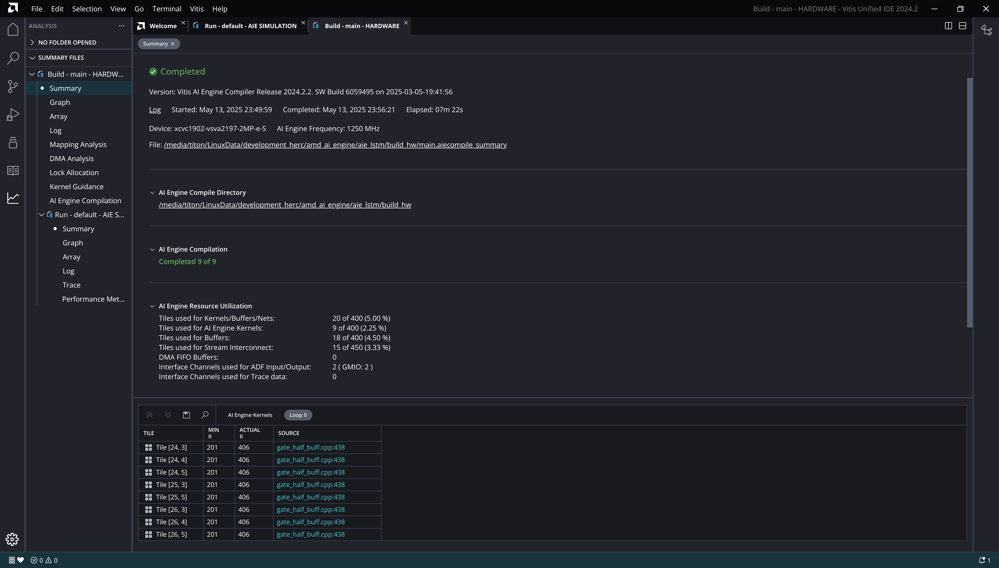
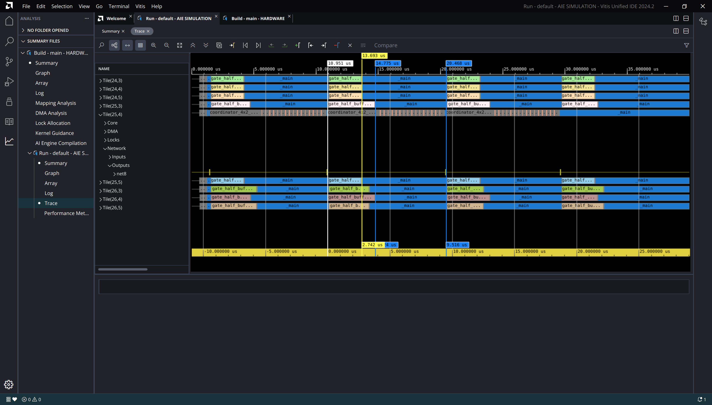

-----------------

# Loop V8

## Loop V8

:::::::::::::: {.columns}
::: {.column width="60%"}

~~~ { #large-code-block .cpp}
...
#elif defined(GATE_HALF_LOOP_V8)
    // - used pointers instead of iterators
    // - pipelining at outer loop
    // - inner loops completely flattened
    // - double accumulator
    // - Improved accumulator reduction
    // - NOTE: min cycle count = 3267
    constexpr int row_block_size = VECTOR_LANES;
    constexpr int n_row_blocks = LSTM_UNITS / 2 / row_block_size;
    constexpr int n_state_blocks = W_STATE_COLS / VECTOR_LANES;
    constexpr int n_input_blocks = INPUT_DIM / VECTOR_LANES;

    const vector<float, VECTOR_LANES> *__restrict state_start_p = state_p;
    const vector<float, VECTOR_LANES> *__restrict inp_start_p = inp_p;

    for (int row_block = 0; row_block < n_row_blocks; row_block++)
        chess_prepare_for_pipelining chess_pipeline_initiation_interval(201) chess_modulo_scheduling_budget_ratio(200) {
            // Compute a block of rows.
            for (int row = 0; row < row_block_size; row++)
                chess_flatten_loop {
                    acc1 = zeros<accfloat, VECTOR_LANES>();
                    acc2 = zeros<accfloat, VECTOR_LANES>();
                    state_p = state_start_p;
                    inp_p = inp_start_p;

                    // Multiply and accumulate with state weight matrix.
                    for (int i = 0; i < n_state_blocks / 2; i++)
                        chess_flatten_loop {
                            va = *w_state_p++;
                            vb = *state_p++;
                            acc1 = mac(acc1, va, vb);

                            vc = *w_state_p++;
                            vd = *state_p++;
                            acc2 = mac(acc2, vc, vd);
                        }

                    // Mutiply and accumulate with input-weight matrix.
                    for (int i = 0; i < n_input_blocks / 2; i++)
                        chess_flatten_loop {
                            va = *w_inp_p++;
                            vb = *inp_p++;
                            acc1 = mac(acc1, va, vb);

                            vc = *w_inp_p++;
                            vd = *inp_p++;
                            acc2 = mac(acc2, vc, vd);
                        }

                    // Sum all of the accumulator lanes.
                    va = acc1.to_vector<float>(0);
                    vb = acc2.to_vector<float>(0);
                    vc = add(va, vb);
                    rslt = reduce_add(vc);

                    // Place the result scalar into the vector.
                    rslt_v.push(rslt);
                }

            rslt_v = reverse(rslt_v);
            // Add bias.
            rslt_v = add(*bias_p++, rslt_v);
            // Forward gate output to coordinator.
            *outp_p++ = rslt_v;
        }
...
~~~

:::

::: {.column width="40%"}

- Use of pointers instead of iterators
- Pipelining at outer loop
- All inner loops flattened
- Double accumulator
- Better accumulator reduction strategy

:::

::::::::::::::

---

## Cycle count (Page 1)

~~~
Loop cycle count: 3269
Loop cycle count: 3268
Loop cycle count: 3267
Loop cycle count: 3278
Loop cycle count: 3889
Loop cycle count: 3913
Loop cycle count: 4544
Loop cycle count: 4555
~~~

-----

## Cycle count (Page 2)

| Loop | Min | Max | Avg | Std |
|------|-----|-----|-----|-----|
| loop_v1 | 5221 | 8086 | 6327.9 | 1057.8 |
| loop_v2 | 6317 | 6525 | 6392.0 | 86.2 |
| loop_v3 | 5535 | 6473 | 5677.2 | 241.6 |
| loop_v4 | 4124 | 4854 | 4278.9 | 247.2 |
| loop_v5 | 4546 | 5900 | 5056.2 | 554.1 |
| loop_v6 | 4124 | 4854 | 4278.9 | 247.2 |
| loop_v7 | 4546 | 5900 | 5056.2 | 554.1 |
| loop_v8 | 3267 | 4623 | 3671.8 | 482.8 |
-----

## Loop Scheduling Log

~~~ {#large-code-block}
...
Scheduling basic blocks ...

HW do-loop #927 in "/media/titon/LinuxData/development_herc/amd_ai_engine/aie_lstm/src/kernels/gate_half_buff.cpp", line 449: (loop #13) :
critical cycle of length 8 : b134 -> b138 -> b136 -> b134
minimum length due to resources: 2
scheduling HW do-loop #927     	-> # cycles: 15 
  -> HW do-loop #927 in "/media/titon/LinuxPortable/xilinx_tools_2024_2/Vitis/2024.2/aietools/include/aie_api/detail/aie1/mul_acc32_fp.hpp", line 41: (loop #13) : 15 cycles

HW do-loop #973 in "/media/titon/LinuxData/development_herc/amd_ai_engine/aie_lstm/src/kernels/gate_half_buff.cpp", line 461: (loop #25) :
critical cycle of length 8 : b128 -> b132 -> b130 -> b128
minimum length due to resources: 2
scheduling HW do-loop #973     	-> # cycles: 15 
  -> HW do-loop #973 in "/media/titon/LinuxPortable/xilinx_tools_2024_2/Vitis/2024.2/aietools/include/aie_api/detail/aie1/mul_acc32_fp.hpp", line 41: (loop #25) : 15 cycles
scheduling macro #1177     	-> # cycles: 35 
scheduling macro #1190     	-> # cycles: 11 
scheduling macro #1202     	-> # cycles: 1 
scheduling macro #73     	-> # cycles: 6 
scheduling macro #75     	-> # cycles: 1 
scheduling macro #81     	-> # cycles: 17 
scheduling macro #1201     	-> # cycles: 3 
scheduling macro #138     	-> # cycles: 2 
scheduling macro #226     	-> # cycles: 11 
scheduling macro #148     	-> # cycles: 11 

Total number of cycles = 128

Checking data/anti-dependencies beyond basic block boundaries
...
...
Compiling all mappings: 0%..10%..20%..30%..40%..50%..60%..70%..80%..90%..100%

flatten loops : #25 #13 #8
review chess_separator_scheduler(offset > 0)
removing chess_separator blocks up to strength 2 in foldable loops

HW do-loop #927 in "/media/titon/LinuxData/development_herc/amd_ai_engine/aie_lstm/src/kernels/gate_half_buff.cpp", line 438: (loop #3) :
critical cycle of length 306 : b579 -> b871 -> b138 -> b136 -> b139 -> b878 -> b882 -> b880 -> b883 -> b884 -> b888 -> b886 -> b889 -> b890 -> b894 -> b892 -> b895 -> b896 -> b900 -> b898 -> b901 -> b902 -> b906 -> b904 -> b907 -> b908 -> b912 -> b910 -> b913 -> b914 -> b918 -> b916 -> b919 -> b129 -> b132 -> b130 -> b133 -> b872 -> b876 -> b874 -> b877 -> b122 -> b501 -> b123 -> b502 -> b124 -> b503 -> b125 -> b126 -> b968 -> b925 -> b926 -> b930 -> b928 -> b931 -> b932 -> b936 -> b934 -> b937 -> b938 -> b942 -> b940 -> b943 -> b944 -> b948 -> b946 -> b949 -> b950 -> b954 -> b952 -> b955 -> b956 -> b960 -> b958 -> b961 -> b962 -> b966 -> b964 -> b967 -> b971 -> b974 -> b972 -> b975 -> b976 -> b980 -> b978 -> b981 -> b984 -> b990 -> b985 -> b991 -> b986 -> b992 -> b987 -> b988 -> b1041 -> b998 -> b999 -> b1003 -> b1001 -> b1004 -> b1005 -> b1009 -> b1007 -> b1010 -> b1011 -> b1015 -> b1013 -> b1016 -> b1017 -> b1021 -> b1019 -> b1022 -> b1023 -> b1027 -> b1025 -> b1028 -> b1029 -> b1033 -> b1031 -> b1034 -> b1035 -> b1039 -> b1037 -> b1040 -> b1044 -> b1047 -> b1045 -> b1048 -> b1049 -> b1053 -> b1051 -> b1054 -> b1057 -> b1063 -> b1058 -> b1064 -> b1059 -> b1065 -> b1060 -> b1061 -> b1114 -> b1071 -> b1072 -> b1076 -> b1074 -> b1077 -> b1078 -> b1082 -> b1080 -> b1083 -> b1084 -> b1088 -> b1086 -> b1089 -> b1090 -> b1094 -> b1092 -> b1095 -> b1096 -> b1100 -> b1098 -> b1101 -> b1102 -> b1106 -> b1104 -> b1107 -> b1108 -> b1112 -> b1110 -> b1113 -> b1117 -> b1120 -> b1118 -> b1121 -> b1122 -> b1126 -> b1124 -> b1127 -> b1130 -> b1136 -> b1131 -> b1137 -> b1132 -> b1138 -> b1133 -> b1134 -> b1187 -> b1144 -> b1145 -> b1149 -> b1147 -> b1150 -> b1151 -> b1155 -> b1153 -> b1156 -> b1157 -> b1161 -> b1159 -> b1162 -> b1163 -> b1167 -> b1165 -> b1168 -> b1169 -> b1173 -> b1171 -> b1174 -> b1175 -> b1179 -> b1177 -> b1180 -> b1181 -> b1185 -> b1183 -> b1186 -> b1190 -> b1193 -> b1191 -> b1194 -> b1195 -> b1199 -> b1197 -> b1200 -> b1203 -> b1209 -> b1204 -> b1210 -> b1205 -> b1211 -> b1206 -> b1207 -> b1260 -> b1217 -> b1218 -> b1222 -> b1220 -> b1223 -> b1224 -> b1228 -> b1226 -> b1229 -> b1230 -> b1234 -> b1232 -> b1235 -> b1236 -> b1240 -> b1238 -> b1241 -> b1242 -> b1246 -> b1244 -> b1247 -> b1248 -> b1252 -> b1250 -> b1253 -> b1254 -> b1258 -> b1256 -> b1259 -> b1263 -> b1266 -> b1264 -> b1267 -> b1268 -> b1272 -> b1270 -> b1273 -> b1276 -> b1282 -> b1277 -> b1283 -> b1278 -> b1284 -> b1279 -> b1280 -> b1333 -> b1290 -> b1291 -> b1295 -> b1293 -> b1296 -> b1297 -> b1301 -> b1299 -> b1302 -> b1303 -> b1307 -> b1305 -> b1308 -> b1309 -> b1313 -> b1311 -> b1314 -> b1315 -> b1319 -> b1317 -> b1320 -> b1321 -> b1325 -> b1323 -> b1326 -> b1327 -> b1331 -> b1329 -> b1332 -> b1336 -> b1338 -> b1342 -> b1344 -> b1348 -> b1409 -> b1412 -> b1410 -> b1413 -> b1414 -> b1418 -> b1416 -> b1419 -> b1422 -> b1428 -> b1423 -> b1429 -> b1424 -> b1430 -> b1425 -> b1426 -> b1427 -> b115 -> b116 -> b117 -> b118 -> b579
minimum length due to resources: 201
scheduling HW do-loop #927
(algo 2)	-> # cycles: 416 
(modulo)	-> # cycles:NOTICE: Minimum pipelined initiation interval is set via chess_pipelined_initiation_interval(201) directive.
 306c 307c 308c 309c 310c 311c 312c 313c 314c 315c 316c 317c 318c 319c 320c 321c 322c 323c 324c 325c 326c 327c 328c 329c 330c 331c 332c 333c 334c 335c 336c 337c 338c 339c 340c 341c 342c 343c 344c 345c 346c 347c 348c 349c 350c 351c 352c 353c 354c 355c 356c 357c 358c 359c 360c 361c 362c 363c 364c 365c 366c 367c 368c 369c 370c 371c 372c 373c 374c 375c 376c 377c 378c 379c 380c 381c 382c 383c 384c 385c 386c 387c 388c 389c 390c 391c 392c 393c 394c 395c 396c 397c 398c 399c 400c 401c 402c 403c 404c 405c 406 ok 405c (required budget ratio: 1)  
(resume algo)	  -> after folding: 406  (folded over 1 iterations)
  -> HW do-loop #927 in "/media/titon/LinuxPortable/xilinx_tools_2024_2/Vitis/2024.2/aietools/include/aie_api/detail/aie1/mul_acc32_fp.hpp", line 41: (loop #3) : 406 cycles
NOTICE: postamble created
removing chess_separator blocks up to strength 2 (all)

jump threading ...
adding manifest flow nodes ...

Constructing flow graphs ...
Scheduling basic blocks ...
scheduling macro #73     	-> # cycles: 6 
scheduling macro #75     	-> # cycles: 4 
scheduling macro #1221     	-> # cycles: 410 
scheduling macro #1201     	-> # cycles: 10 
scheduling macro #138     	-> # cycles: 5 
scheduling macro #226     	-> # cycles: 7 
scheduling macro #148     	-> # cycles: 11 

Total number of cycles = 859

Checking data/anti-dependencies beyond basic block boundaries
Checking resource conflicts beyond basic block boundaries
Checking pipeline hazards ...

Instruction alignment adds 14 extra words
Filling in loop counts in instruction enabling ...
Re-filling in 'a', 'r' values in instruction enabling ...
Adjusting target addresses ...
...
~~~

## Loop II

## Performance Analysis

- Simulation AIE clock speed: 1.25GHz
- Avg. time taken (nsec): $t = 3671.8 / 1.25$
- Avg. performance per gate (GMAC/s): $P = 10240 / t = 3.48$
- Theoretical maximum: 8 GMAC/s
- Percent core utilization: 43.57%
- Improvement on all previous iterations.
- Can we do better?

## Report

- [Kernel compilation log](results/loop_v8/24_4.log)
- [Simulator log](results/loop_v8/AIESimulator.log)
- [Micro-code listing](results/loop_v8/gate_half_buff.o.lst)
- [Report dir](results/loop_v8/)

## Trace

