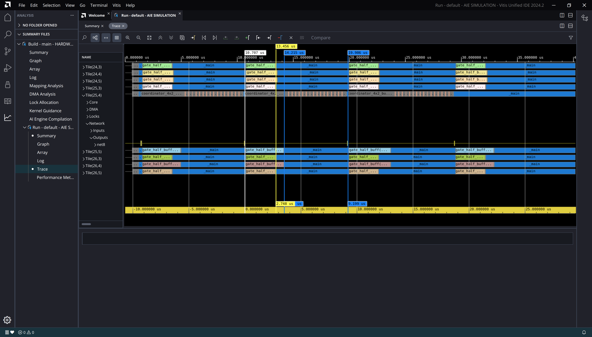

-----------------

# Loop V8 with Buffer Optimization

## Loop V8 with Buffer Optimization

- Kernel is same as V8
- Buffer optimization label set to 5, instead of 0
- Two gates have huge latency!

## Cycle count (Page 1)

~~~
Loop cycle count: 3267
Loop cycle count: 3267
Loop cycle count: 3270
Loop cycle count: 3285
Loop cycle count: 3400
Loop cycle count: 3407
Loop cycle count: 4210
Loop cycle count: 4218
~~~

## Cycle count (Page 2)

| Loop | Min | Max | Avg | Std |
|------|-----|-----|-----|-----|
| loop_v1 | 5221 | 8086 | 6327.9 | 1057.8 |
| loop_v2 | 6317 | 6525 | 6392.0 | 86.2 |
| loop_v3 | 5535 | 6473 | 5677.2 | 241.6 |
| loop_v4 | 4124 | 4854 | 4278.9 | 247.2 |
| loop_v5 | 4546 | 5900 | 5056.2 | 554.1 |

## Cycle count (Page 3)

| Loop | Min | Max | Avg | Std |
|------|-----|-----|-----|-----|
| loop_v6 | 4124 | 4854 | 4278.9 | 247.2 |
| loop_v7 | 4546 | 5900 | 5056.2 | 554.1 |
| loop_v8 | 3267 | 4623 | 3671.8 | 482.8 |
| loop_v8_buff_opt | 3267 | 4428 | 3554.0 | 420.7 |

## Performance Analysis

- Simulation AIE clock speed: 1.25GHz
- Avg. time taken (nsec): $t = 3554.0 / 1.25$
- Avg. performance per gate (GMAC/s): $P = 10240 / t = 3.60$
- Theoretical maximum: 8 GMAC/s
- Percent core utilization: 45.02%
- Slight improvement on plain V8.

## Report

- [Kernel compilation log](results/loop_v8_buff_opt_lvl5/24_4.log)
- [Simulator log](results/loop_v8_buff_opt_lvl5/AIESimulator.log)
- [Micro-code listing](results/loop_v8_buff_opt_lvl5/gate_half_buff.o.lst)
- [Report dir](results/loop_v8_buff_opt_lvl5/)

## Trace

